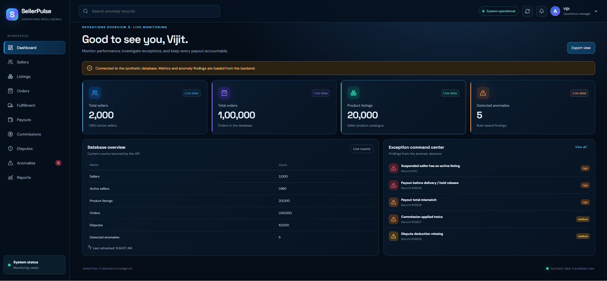
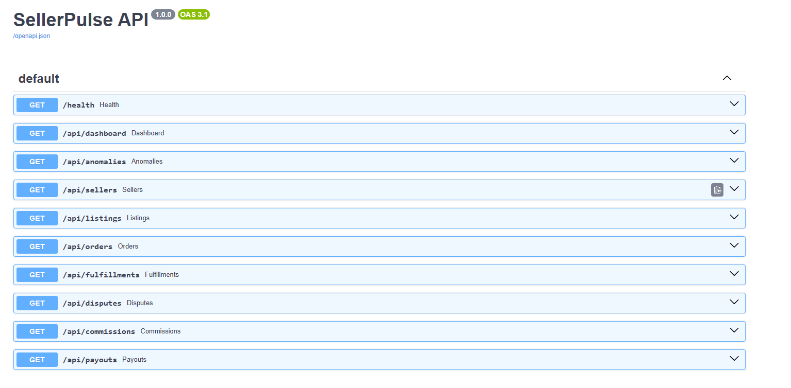
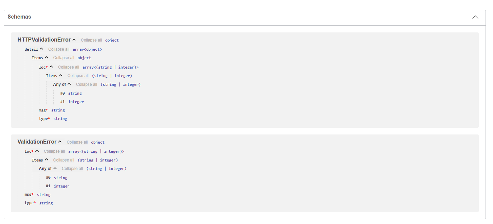
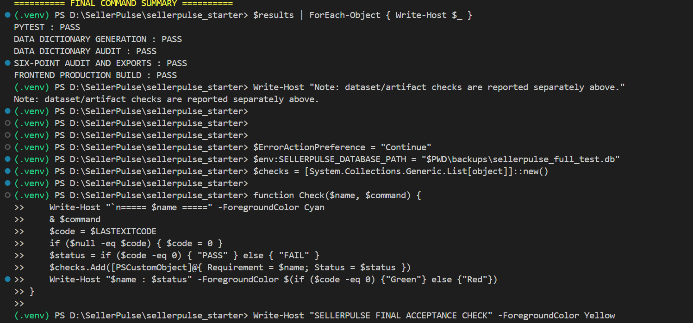
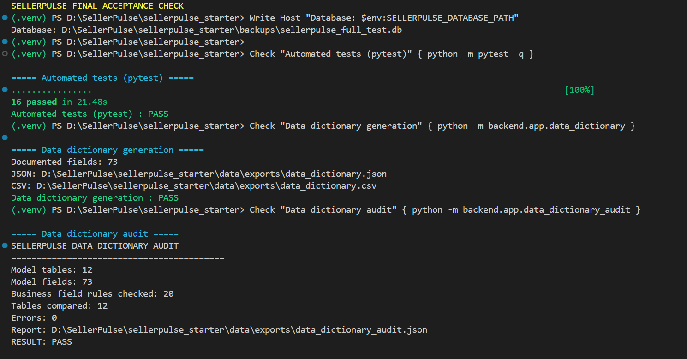
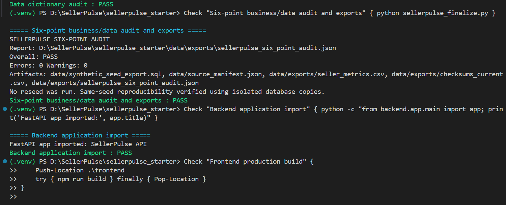
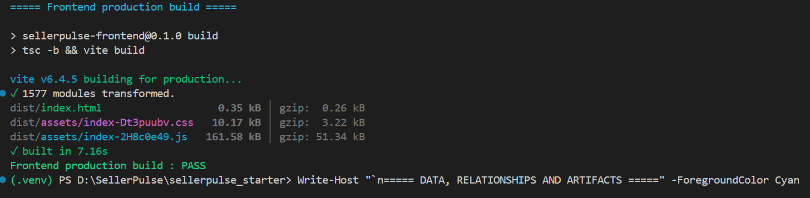
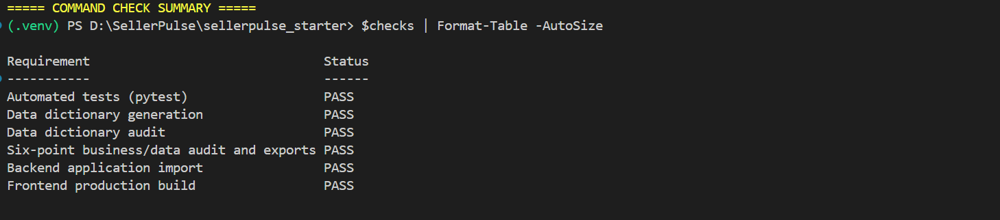

# SellerPulse — Seller Operations & Payout Intelligence

SellerPulse is a full-stack marketplace operations application that helps monitor sellers, validate payout calculations, and identify financial and operational anomalies using synthetic marketplace data.

## Problem Statement

Online marketplaces process large volumes of sellers, listings, orders, deliveries, commissions, disputes, and payouts. Manually validating these operations becomes difficult as transaction volumes grow.

Operational inconsistencies can lead to premature payouts, duplicate commission deductions, missing dispute deductions, incorrect payout totals, and invalid seller listings.

**SellerPulse addresses these challenges through structured marketplace data, business-rule validation, payout reconciliation, and anomaly detection.** It provides dashboard metrics and API endpoints to help users identify records that may require investigation.

## Problem Statement Coverage

| Requirement / challenge | SellerPulse implementation |
|---|---|
| Monitor marketplace operations | Dashboard metrics and API endpoints |
| Manage seller and listing information | Sellers and product listings data |
| Track orders and fulfillment | Orders, order lines, seller-level orders, and fulfillments |
| Validate payout calculations | Payout and payout-line records with reconciliation checks |
| Apply commission rules | Commission rules and duplicate commission detection |
| Enforce payout eligibility | Checks for payouts before delivery or hold release |
| Identify invalid seller listings | Suspended seller with active listing detection |
| Account for disputes | Missing dispute deduction detection |
| Identify incorrect payout totals | Payout total mismatch detection |
| Validate results reproducibly | Synthetic data, fixed seed, ground-truth labels, and validation reports |
| Test business logic | Automated Pytest suite |

These implementations address the documented project scope. Anomaly flags identify potential inconsistencies; they do not independently prove fraud or guarantee that every possible real-world anomaly will be detected.

## Key Features

- Seller operations dashboard
- Payout and commission reconciliation
- Five targeted anomaly detection scenarios
- FastAPI REST endpoints
- SQLite relational database with SQLAlchemy
- Reproducible synthetic marketplace data
- Validation reports and automated tests

## Tech Stack

- **Frontend:** React, TypeScript, Vite
- **Backend:** Python, FastAPI, Uvicorn
- **Database:** SQLite, SQLAlchemy
- **Testing:** Pytest
- **Version control:** Git and GitHub

## Project Structure

```text
SellerPulse/
├── backend/
├── frontend/
├── data/
├── docs/
├── scripts/
├── tests/
├── README.md
├── PROMPT_HISTORY.md
└── .gitignore
```

## Setup and Installation

Follow these steps to run SellerPulse on Windows.

### 1. Install prerequisites

Install Python 3.12.x from [python.org](https://www.python.org/downloads/), Node.js 20.x from [nodejs.org](https://nodejs.org/), and Git from [git-scm.com](https://git-scm.com/).

During Python installation, enable **Add Python to PATH**.

Verify the installations in PowerShell:

```powershell
python --version
python -m pip --version
node --version
npm --version
git --version
```

The development environment used Python 3.12.0, Node.js 20.18.3, and npm 10.8.2.

### 2. Clone the repository

```powershell
git clone https://github.com/vijitkumar07/SellerPulse.git
cd SellerPulse
```

### 3. Create and activate the Python environment

Run these commands from the repository root:

```powershell
python -m venv .venv
.\.venv\Scripts\Activate.ps1
```

If PowerShell blocks activation, run:

```powershell
Set-ExecutionPolicy -Scope Process -ExecutionPolicy Bypass
.\.venv\Scripts\Activate.ps1
```

### 4. Install backend dependencies

```powershell
python -m pip install --upgrade pip
python -m pip install -r backend/requirements.txt
python -m pip check
```

The backend dependency set includes FastAPI, Uvicorn, Pytest, HTTPX, and SQLAlchemy, with versions specified in the project requirements.

### 5. Initialize and seed the database

From the repository root:

```powershell
python -m backend.app.init_db
python -m backend.app.seed --scale full --seed 4242
```

Wait for database initialization and data generation to finish before starting the backend.

The fixed seed supports reproducible synthetic data generation.

### 6. Start the backend

```powershell
python -m uvicorn backend.app.main:app --reload
```

Keep this terminal open.

- Backend: [http://127.0.0.1:8000](http://127.0.0.1:8000)
- API documentation: [http://127.0.0.1:8000/docs](http://127.0.0.1:8000/docs)
- Health endpoint: [http://127.0.0.1:8000/health](http://127.0.0.1:8000/health)

### 7. Install frontend dependencies

Open a second terminal and navigate to the frontend:

```powershell
cd frontend
npm install
```

Wait for installation to complete.

### 8. Start the frontend

In the same terminal:

```powershell
npm run dev
```

Open the URL printed by Vite, normally [http://localhost:5173](http://localhost:5173).

Keep both backend and frontend terminals running while using the application.

### 9. Run tests

Open another terminal at the repository root and activate the virtual environment if necessary.

```powershell
python -m pytest -v
```

## Anomaly Detection

SellerPulse implements checks for these five scenarios:

1. **Premature payout:** A payout occurs before delivery or the required hold-release condition.
2. **Duplicate commission:** Commission is deducted more than once.
3. **Suspended seller with active listing:** Seller status conflicts with listing status.
4. **Missing dispute deduction:** A required dispute amount is not deducted from the payout.
5. **Payout total mismatch:** A payout's recorded total differs from the expected amount.

## Data and Validation

The project includes synthetic marketplace data, a source manifest, ground-truth labels, and validation reports.

The documented dataset contains:

- 2,000 sellers
- 20,000 product listings
- 100,000 orders
- 166,667 order lines
- 166,667 seller-level orders
- 166,667 fulfillments
- 10,000 customer reviews
- 10,000 disputes
- 2 commission rules
- 16,639 payouts
- 16,639 payout lines
- 293,306 entity events

Ground-truth labels are maintained separately from ordinary detector input to support evaluation without directly feeding those labels into the detector.

Validation reports and data exports are available in `data/exports/`. They document checks performed on the dataset and project outputs; they should not be interpreted as proof of production readiness or complete detection of all possible anomalies.

## Database Schema

See [docs/SCHEMA.md](docs/SCHEMA.md) for table definitions, field descriptions, and relationships.

## Screenshots

















## AI-Assisted Development

Development assistance and prompt history are documented in [PROMPT_HISTORY.md](PROMPT_HISTORY.md).

## Security and Limitations

- The project uses synthetic data rather than real marketplace records.
- Anomaly results indicate potential issues requiring review.
- The application is a development and demonstration project, not a production-ready financial platform.
- Do not commit credentials, environment files, or local database files.

## Author

**Vijit Kumar**

[GitHub Repository](https://github.com/vijitkumar07/SellerPulse)